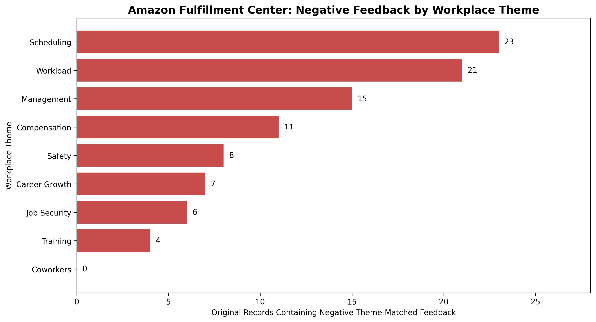
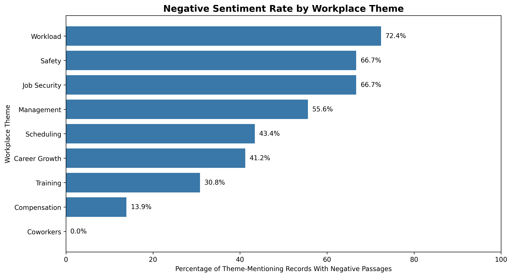

# Amazon Fulfillment Center Employee Voice Analytics

### Python | Pandas | Natural Language Processing | People Analytics

## Project Overview

For this project, I wanted to understand what Amazon fulfillment center employees experience at work and which workplace issues might contribute to high employee turnover.

I used Python, Pandas, and Natural Language Processing (NLP) to analyze employee feedback from Glassdoor and YouTube. My goal was to identify common workplace concerns, compare positive and negative feedback, and use my findings to recommend ways Amazon might improve the employee experience.

## Business Question

What are the biggest workplace concerns mentioned by Amazon fulfillment center employees, and what changes should Amazon consider to improve employee satisfaction and retention?

## Dataset and Methodology

I analyzed 148 source records:
- 138 Glassdoor employee reviews
- 10 YouTube video transcripts

### My Approach

1. **Data Preparation:** Used Pandas to organize employee feedback, check for missing values, and standardize the datasets.
2. **Sentiment Analysis:** Applied a pretrained RoBERTa model to classify feedback as positive, negative, or neutral.
3. **Model Evaluation:** Manually labeled 40 feedback entries to compare human judgments against the model's predictions.
4. **Theme Detection:** Used keyword matching to identify workplace topics such as workload, scheduling, management, pay, and training.
5. **Business Analysis:** Compared workplace concerns across Glassdoor and YouTube, as well as regular and part-time employees.

### Model Performance

| Metric | Result |
|---|---|
| Accuracy | 70.0% |
| Macro F1 Score | 0.70 |
| Negative Recall | 63.2% |
| Manually Reviewed Entries | 40 |

The model performed better at recognizing clearly negative feedback than complaints expressed indirectly. I kept this limitation in mind when interpreting the results.

## Key Findings

Three workplace concerns stood out in my analysis.

### 1. Workload and Physical Demands

Of the 29 records mentioning workload, 21 contained negative theme-matched feedback (72.4%).

Employees frequently discussed physical exhaustion, repetitive tasks, and demanding productivity expectations.

### 2. Scheduling and Work-Life Balance

Scheduling appeared in 53 records, with 23 containing negative theme-matched feedback (43.4%).

Common concerns included long shifts, mandatory overtime, and limited flexibility.

### 3. Management and Communication

Management appeared in 27 records, with 15 containing negative theme-matched feedback (55.6%).

Employees described concerns involving communication, leadership support, and workplace expectations.

### Summary of Findings

| Workplace Theme | Records Mentioning Theme | Records With Negative Feedback | Negative Share |
|---|---:|---:|---:|
| Scheduling | 53 | 23 | 43.4% |
| Workload | 29 | 21 | 72.4% |
| Management | 27 | 15 | 55.6% |
| Compensation | 79 | 11 | 13.9% |
| Safety | 12 | 8 | 66.7% |
| Training | 13 | 4 | 30.8% |

These percentages represent records containing negative theme-matched passages, not verified employee dissatisfaction rates.

## Data Visualizations

### Negative Feedback by Workplace Theme



### Negative Sentiment Rate by Workplace Theme



## Business Recommendations

Based on the patterns I found, I would recommend Amazon investigate three areas.

### 1. Reduce Physical Workload Concerns

Test task rotation and review physically demanding responsibilities to address employee fatigue.

**Success Metrics:** Employee fatigue reports, workplace injuries, and 90-day retention.

### 2. Improve Scheduling Practices

Review overtime expectations, shift predictability, and break practices to improve work-life balance.

**Success Metrics:** Employee scheduling satisfaction and overtime hours.

### 3. Strengthen Management Communication

Introduce regular employee check-ins and manager coaching to address concerns earlier.

**Success Metrics:** Employee engagement scores and management-related complaints.

These recommendations are proposed improvements, not proven solutions. Testing their impact would require internal employee records and performance data.

## What I Learned

One of my biggest takeaways from this project was learning how challenging sentiment analysis becomes when working with real employee feedback.

My original approach struggled to identify negative experiences unless employees used clearly negative language. After testing different NLP models and manually evaluating predictions, I learned why checking model performance is important.

I also learned how important it is to question the results instead of accepting every prediction.

I originally focused on employee training as a possible reason for turnover. After improving my analysis, I found stronger preliminary evidence for investigating workload and scheduling.

Overall, this project helped me strengthen my Python, data analytics, and problem-solving skills while learning how to turn employee feedback into business recommendations.

## Repository Guide

- `notebooks/employee_voice_analysis.ipynb`: Python analysis workflow.
- `scripts/check_outputs.py`: Data integrity verification script.
- `figures/`: Project visualizations.
- `final_theme_summary.csv`: Workplace theme and sentiment results.
- `source_comparison.csv`: Glassdoor and YouTube comparisons.
- `employment_comparison.csv`: Regular and part-time employee comparisons.
- `business_recommendations.csv`: Proposed improvements and success metrics.
- `requirements.txt`: Python dependencies.

Original employee reviews and transcripts are excluded from this public repository.

## How to Run the Project

1. Download or clone this repository.
2. Install dependencies:

   ```bash
   pip install -r requirements.txt
   ```

3. Place your authorized source files in `data/source/`:
   - `glassdoor_cleaned.csv`
   - `youtube_dataset_cleaned.csv`
4. Open `notebooks/employee_voice_analysis.ipynb` in Jupyter Notebook or Google Colab.
5. Run the notebook cells in order from the project root.
6. Run the verification script against the required exported datasets:

   ```bash
   python scripts/check_outputs.py
   ```

The notebook depends on the source files and downloads pretrained NLP models. Reproducing the exact predictions also depends on the installed model and library versions.

## Project Limitations

This project uses selected publicly available employee feedback, so the results don't represent every Amazon fulfillment center employee. Internal Amazon HR data was not used.

The sentiment model achieved 70% accuracy on a small evaluation sample, meaning some feedback was classified incorrectly. Keyword-based theme detection also misses certain workplace concerns.


## Data Use

Original review text and YouTube transcripts are excluded from this public repository. Source material should only be redistributed when permitted by the relevant platforms and rights holders.
